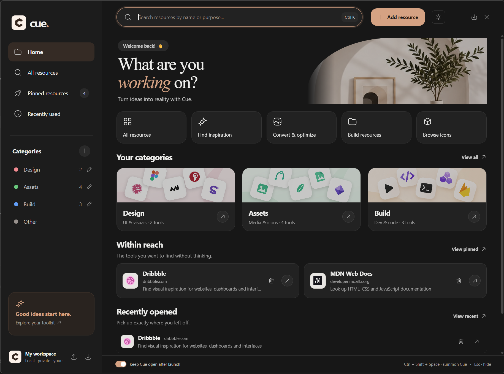

# Cue

**Your tools should be within reach, not buried in bookmarks.**

Cue is a personal desktop workspace for the websites and resources you use while building things. Save a link once, describe what it helps you do, and find it again by name, purpose, keyword, or category. Open resources in your default browser without remembering where you bookmarked them.

Built with Electron and vanilla JavaScript, with local storage, light and neutral charcoal themes, and a warm clay accent.



## Why Cue Exists

As developers, we discover useful tools almost every day: design inspiration, icon libraries, documentation, image converters, developer utilities, and countless other resources.

But finding those tools again shouldn't be a task of its own.

Browser bookmarks are easy to forget, keeping dozens of tabs open creates clutter, and searching for the same website repeatedly interrupts our workflow. Useful resources end up scattered across browsers, pinned tabs, and bookmark folders.

**Cue was built to solve this small but recurring problem.**

The idea is simple: create a personal desktop workspace where useful resources are always within reach, without having to remember URLs, dig through bookmarks, or keep websites open.

Cue brings your tools together in one organized, searchable place. Categorize resources, pin frequently used tools, revisit recently opened websites, and launch what you need with minimal effort.

### The Philosophy

**Your tools should be within reach, not buried in bookmarks.**

Cue is a simple companion to your existing workflow, designed around three actions: **save a resource, find it when you need it, and get back to work.** Your browser still opens the websites; Cue gives your saved resources a consistent home.

Keep organization optional, keep the interface calm, and keep saved data on your device. Open Cue when you need a resource, then minimize it or leave it running in the tray.

## What You Can Do

- **Save quickly:** paste a URL; an editable domain name fills automatically. Purpose, keywords, and category are optional.
- **Find by purpose:** search for what you need to do, as well as names, domains, keywords, and categories.
- **Organize your way:** create and rename categories. Existing links follow category renames; uncategorized links live in Other.
- **Keep favorites close:** pin resources and revisit recently opened websites.
- **Manage saved links:** edit, unpin, or delete resources, with confirmation before deletion.
- **Recognize websites:** automatic favicons with an initials fallback when icons cannot load.
- **Choose your theme:** light or neutral charcoal dark mode with Cue's warm clay accent. Your choice is remembered; until you choose, Cue follows the system theme.
- **Stay within reach:** taskbar, system tray, and a global shortcut. Choose whether Cue stays visible after opening a website.
- **Back up your collection:** export and import JSON backups. Imports merge resources and categories without duplicating existing URLs.

Design, Assets, and Build are starting categories, with editable example resources to help you get going.

## A Quick Workflow

1. Find a useful website and copy its URL.
2. Show Cue with **Ctrl + Shift + Space**.
3. Press **Ctrl + N** to add a resource. A valid URL from your clipboard fills automatically.
4. Optionally add a purpose such as `Find dashboard UI inspiration`, then save.
5. Later, press **Ctrl + K**, search for `dashboard inspiration`, and open the resource.

## Run Locally

Install Node.js LTS and npm, then run:

```sh
git clone https://github.com/heyzain/cue-developer.git
cd cue-developer
npm ci
npm start
```

Use `npm run dev` to start with developer tools.

On Windows, you can also double-click `run-windows.cmd`. It installs dependencies and downloads the Electron runtime if missing, then starts Cue with a terminal attached. Startup output is saved to `cue-launch.log`; closing that terminal can stop the app.

## Keyboard Shortcuts

| Shortcut | Action |
| --- | --- |
| Ctrl + Shift + Space | Show Cue, or hide it when focused; works while Cue is running in the background |
| Ctrl + Alt + Space | Fallback if the primary global shortcut is unavailable |
| Ctrl + N | Add a resource, using a valid clipboard URL when available |
| Ctrl + K or / | Focus search |
| Up / Down, then Enter | Select and open a search result |
| Esc | Dismiss a dialog, clear search, or hide Cue |

Except for the global show/hide shortcut, these shortcuts work while Cue is active.

**Minimize** sends Cue to the taskbar. **Close** and **Hide to tray** keep it running in the system tray. To exit completely, right-click the tray icon and choose **Quit Cue completely**. If global shortcuts are unavailable, use the taskbar or tray.

## Local Data and Backups

Cue needs no account to save and search resources. Desktop data lives in `cue-data.json` inside Electron's `app.getPath('userData')` directory, outside this repository. On Windows, this is normally under `%APPDATA%`; the exact folder depends on the application identity and how Cue is launched.

Source updates preserve saved resources while the application identity and data path stay the same. Export important links before changing either. Backups include resources and categories, including empty custom categories. Import merges these into your collection; it does not restore exported preferences. The theme choice is stored separately on the device.

Website icons use Google's favicon service with only the website hostname, without saved URL paths, queries, or fragments. Private IP addresses and local hostnames use initials. Images use the browser's HTTP cache; failed or offline requests keep the initials fallback. Opening websites and fetching icons require an internet connection.

Opening `index.html` directly provides a browser preview with separate `localStorage`. It does not share desktop data or provide desktop window controls, global shortcuts, or tray integration.

## Customize the Icons

Replace SVG files in `assets/icons/` with your Figma exports using the **same filenames**, then reload Cue. No code changes are needed. For a packaged installation, replace the source files and rebuild.

- Use a transparent background and a consistent `24 × 24` viewBox.
- Icons inherit the interface color in light/dark themes and hover states through SVG alpha masks.
- For duotone icons, express the secondary tone using opacity. Solid multicolor fills become one interface color.
- Website favicons, the Cue logo, and category artwork use separate assets.

## Build for Windows

```sh
# Portable executable
npm run dist:portable

# NSIS installer
npm run dist:win
```

Output goes to `release/`. On Windows, `build-windows.cmd` installs dependencies and builds the portable executable. Windows is the configured packaging target; macOS and Linux packaging has not been configured or verified. Builds are unsigned. Launch at system startup is not implemented.

## Project Structure

| Path | Purpose |
| --- | --- |
| `main.js` | Electron window, tray, global shortcuts, local data, and IPC handlers |
| `preload.js` | Restricted bridge between the interface and Electron |
| `index.html` | App shell, forms, and dialogs |
| `renderer.js` | Resource management, search, navigation, and browser-preview storage |
| `resources.js` | Shared URL, favicon, and category rules |
| `theme.js` | Theme selection and persistence |
| `styles.css` | Layout, themes, responsive styles, and icon masks |
| `seed.js` | Editable example resources |
| `assets/icons/` | Replaceable interface SVGs |
| `assets/` | Branding and decorative artwork |
| `docs/screenshots/` | README screenshots |
| `tests/` | Resource and theme logic tests |
| `scripts/` | Startup helpers and the Electron UI smoke test |

## Development Checks

```sh
npm test
npm run test:ui
```

Logic tests cover category migration and renaming, URL validation, favicon URLs, and theme persistence. The UI smoke test uses temporary data and checks save/search, icon fallback, theme behavior, categories, and deletion. It requires a working Electron runtime with Windows sandbox permissions.

For desktop changes, also verify startup, import/export, browser launches, minimize, tray reopening, and global shortcuts.
